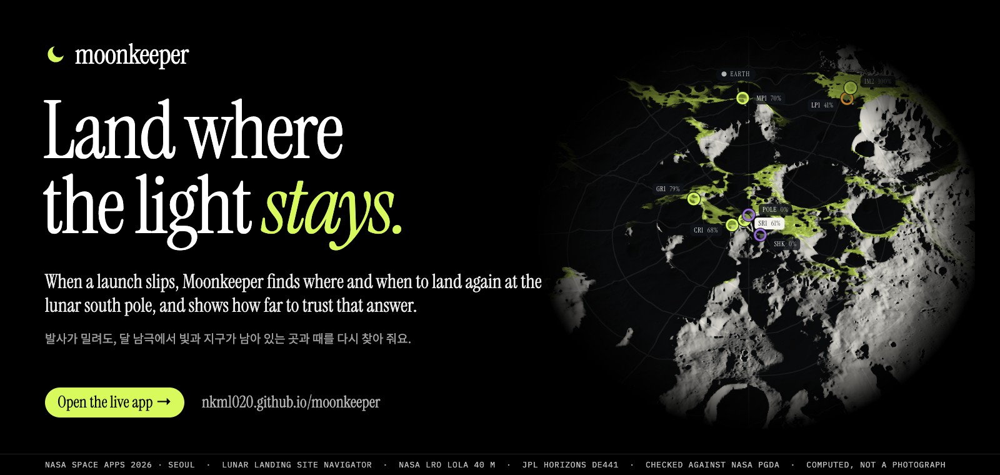
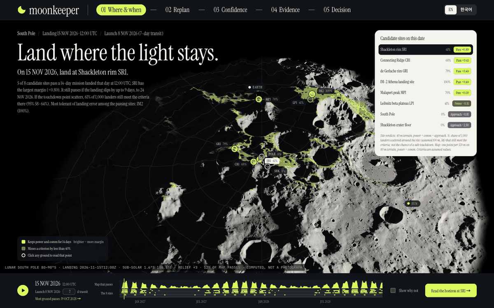
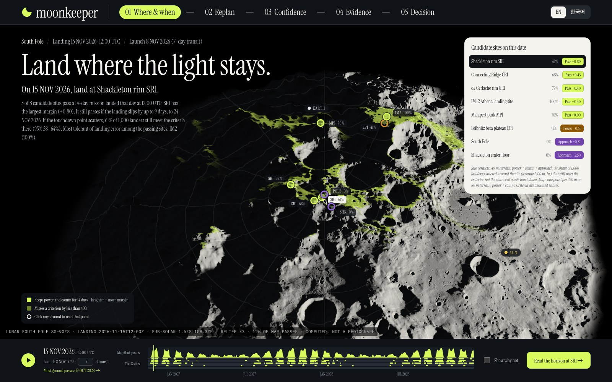
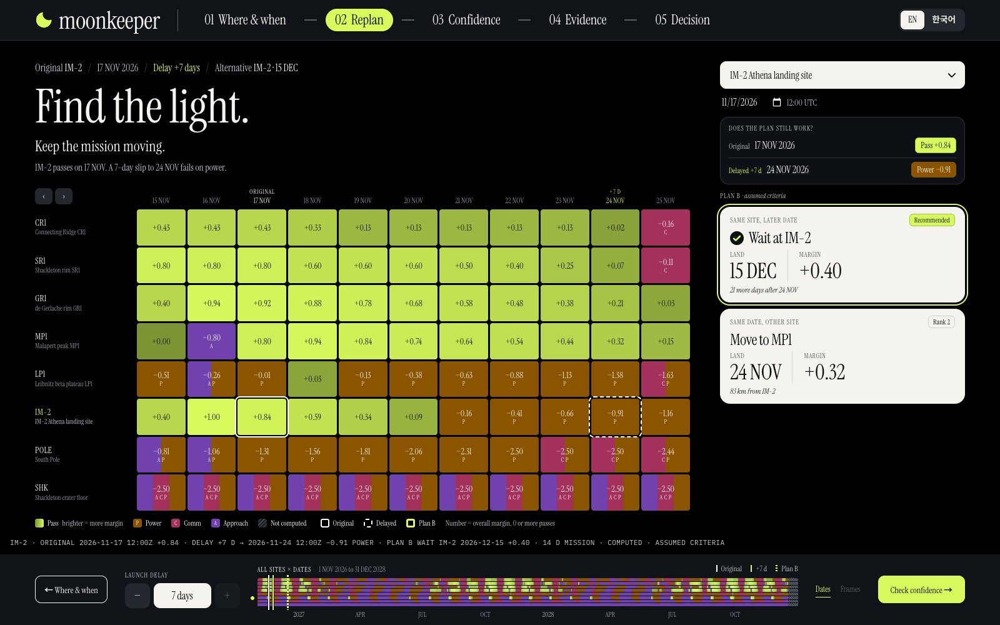
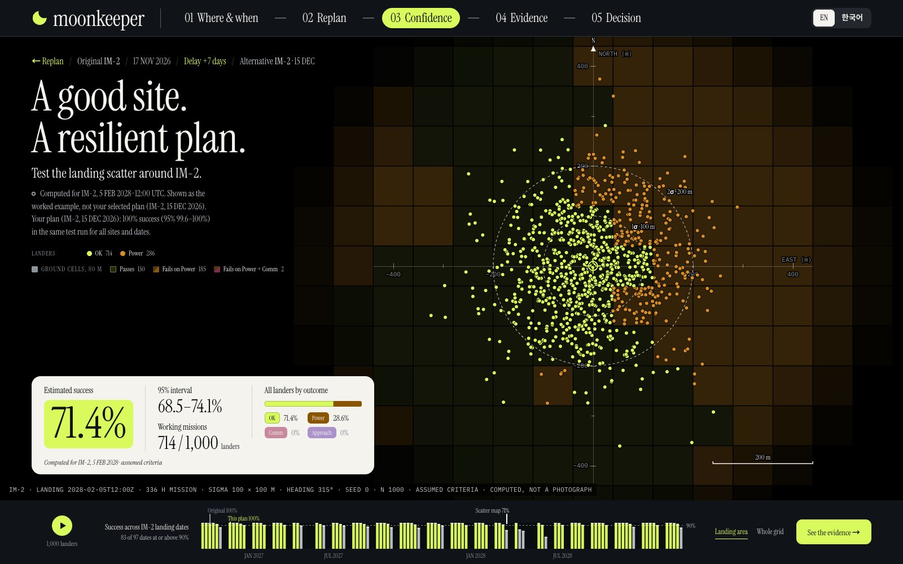
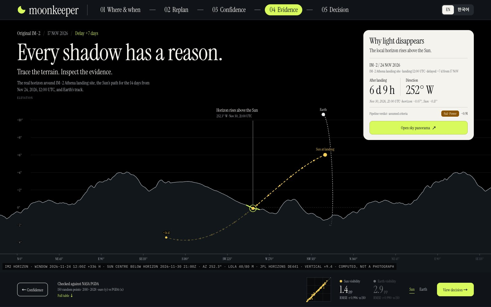
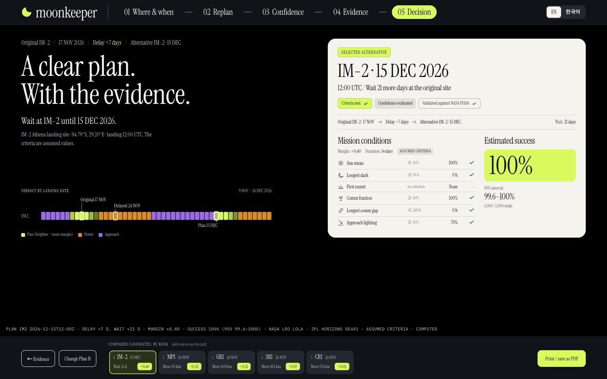
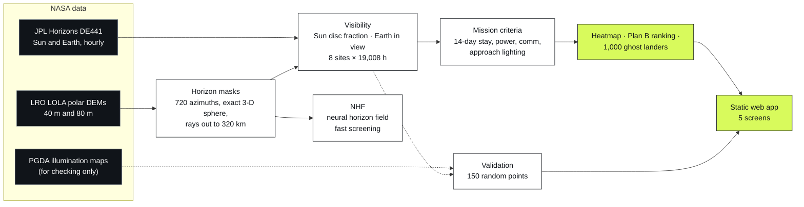
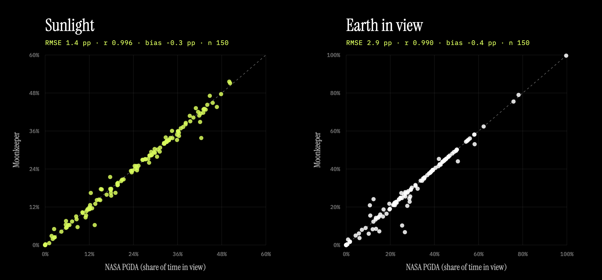

<a href="https://nkm1020.github.io/moonkeeper/"></a>

<p align="center">
  <a href="https://nkm1020.github.io/moonkeeper/"><b>Open the live app</b></a>
  &nbsp;·&nbsp;
  <a href="https://nkm1020.github.io/moonkeeper/web/#step=replan&site=im2&time=2026-11-17T12:00Z&delay=7"><b>Play the 7-day slip story</b></a>
  &nbsp;·&nbsp;
  <a href="#how-it-works">How it works</a>
  &nbsp;·&nbsp;
  <a href="#checked-against-nasa">Validation</a>
  &nbsp;·&nbsp;
  <a href="#한국어">한국어</a>
</p>

<p align="center"><sub>NASA Space Apps Challenge 2026 · Seoul · Lunar Landing Site Navigator</sub></p>

<br>

At the lunar south pole the Sun skims the horizon. A ridge a few degrees high can put a lander in shadow for days, and a launch that slips by one week can turn a good landing site into a dead one.

**Moonkeeper answers the question a mission team asks when the launch date moves: _where and when do we land now, and how far can we trust that answer?_** It computes Sun and Earth visibility from real NASA terrain for every hour from November 2026 to December 2028. Then it replans the landing and shows the evidence behind each verdict.

<br>

## The 30-second story

<p align="center"></p>

The plan is to land at the **IM-2 Athena landing site** on 17 Nov 2026. Then the launch slips by 7 days.

| | Landing | Verdict |
| :-- | :-- | :-- |
| **Original plan** | IM-2 · 17 Nov 2026, 12:00 UTC | ✅ Passes · margin **+0.84** |
| **Launch slips 7 days** | IM-2 · 24 Nov 2026 | ❌ **Fails on power** (−0.91). On 30 Nov at 21:00 UTC the Sun sinks behind the ridge at azimuth 252° and stays down too long. |
| **Plan B, ranked first** | IM-2 · **15 Dec 2026** (wait 21 days) | ✅ Passes · margin **+0.40** · 100% of 1,000 scattered landers still meet the criteria (95% interval 99.6–100%) |
| Plan B, ranked second | MP1 (Malapert peak), 83 km away · 24 Nov 2026 | ✅ Passes · margin +0.32 |

Every number in this table comes from computed files in [`data/outputs/`](data/outputs). None of it is hand-typed.

<br>

## At a glance

<table>
<tr>
<td align="center" width="20%"><h2>8</h2>candidate landing sites near the south pole</td>
<td align="center" width="20%"><h2>19,008</h2>hourly Sun and Earth positions, Nov 2026 – Dec 2028</td>
<td align="center" width="20%"><h2>1.18 M</h2>ground points on the opening map, one every 320 m</td>
<td align="center" width="20%"><h2>1,000</h2>scattered landers per landing test</td>
<td align="center" width="20%"><h2>1.4 pp</h2>RMSE against NASA PGDA sunlight maps at 150 random points</td>
</tr>
</table>

<br>

## Five screens, one decision

<table>
<tr>
<td colspan="2">
<a href="https://nkm1020.github.io/moonkeeper/web/#step=sky"></a>
<h3>01 · Where &amp; when — <i>Land where the light stays.</i></h3>
The answer comes first. The real south-pole terrain is shaded for the chosen date, and the lime ground keeps power and Earth contact for a 14-day mission. The eight sites are ranked on the right, and the strip at the bottom plays every date through 2028. You can also switch to a path-traced photograph of the site at that hour.
</td>
</tr>
<tr>
<td width="50%" valign="top">
<a href="https://nkm1020.github.io/moonkeeper/web/#step=replan&site=im2&time=2026-11-17T12:00Z&delay=7"></a>
<h3>02 · Replan — <i>Find the light.</i></h3>
Eight sites × the days around the slip, each cell colored by its real margin and marked with the cause of failure (power, comm, approach). Plan B appears as two cards: wait at the same site, or move to another site on the same date.
</td>
<td width="50%" valign="top">
<a href="https://nkm1020.github.io/moonkeeper/web/#step=ghosts&site=im2&time=2026-11-17T12:00Z&delay=7&planb=im2"></a>
<h3>03 · Confidence — <i>A good site. A resilient plan.</i></h3>
A lander never touches down exactly on the target point. We scatter 1,000 "ghost landers" around it (σ = 100 m) and rerun the verdict for each one. In this worked example, 71.4% still meet every criterion.
</td>
</tr>
<tr>
<td width="50%" valign="top">
<a href="https://nkm1020.github.io/moonkeeper/web/#step=explain&site=im2&time=2026-11-17T12:00Z&delay=7&planb=im2"></a>
<h3>04 · Evidence — <i>Every shadow has a reason.</i></h3>
The real horizon around the site and the Sun's path over 14 days. The screen marks the exact moment the terrain hides the Sun. The NASA PGDA check is shown at the bottom.
</td>
<td width="50%" valign="top">
<a href="https://nkm1020.github.io/moonkeeper/web/#step=decision&site=im2&time=2026-11-17T12:00Z&delay=7&planb=im2"></a>
<h3>05 · Decision — <i>A clear plan. With the evidence.</i></h3>
One card a flight director could sign: the new date, the margin, a check against each criterion, the confidence, and the ranked alternatives. It can be printed or saved as a PDF.
</td>
</tr>
</table>

<sub>Click any screen to open it live. The English screens use a serif typeface, and the Korean screens keep Noto Sans KR. You can switch with the EN / 한국어 button at the top right.</sub>

<br>

## How it works

All the heavy computation runs once, in Python, and is saved as JSON. The web app only reads those files and draws them. It has no server and does no math at view time. It is plain static files on GitHub Pages.



| Step | What we do | Where |
| :-- | :-- | :-- |
| **Terrain** | NASA LRO LOLA polar DEMs (`LDEM_85S_40M`, `LDEM_80S_80M`). We use 40 m data where it exists. | [`pipeline/terrain.py`](pipeline/terrain.py) |
| **Horizon** | From each site, we follow great circles in 720 directions and keep the highest terrain angle. Lunar curvature is included. | [`pipeline/terrain.py`](pipeline/terrain.py) |
| **Sky** | Sun and Earth azimuth, elevation and angular size for every hour, taken from the JPL Horizons API in the MEAN_ME frame. | [`pipeline/fetch_horizons.py`](pipeline/fetch_horizons.py) |
| **Visibility** | We record how much of the Sun's disc is above the local horizon, and whether any part of Earth is in view. The mast is 2 m high. | [`pipeline/make_inputs.py`](pipeline/make_inputs.py) |
| **Approach lighting** | We check that the ground under the descent camera is lit, 0.5–10 km uprange, from 8 approach directions. | [`pipeline/make_inputs.py`](pipeline/make_inputs.py) |
| **Verdicts** | We check each landing hour against the mission criteria and rank Plan B options. | [`pipeline/moonkeeper_b/`](pipeline/moonkeeper_b), [`pipeline/run_heatmap.py`](pipeline/run_heatmap.py) |
| **Ghost landers** | We scatter 1,000 landers around the target and rerun the verdict for each one. | [`pipeline/run_ghost_landers.py`](pipeline/run_ghost_landers.py) |
| **NHF** | A neural horizon field gives horizons about 400× faster than ray casting (317 points in 0.21 s, versus 82 s for ray casting). We use it for fast screening, and the precise horizons make the final call. | [`pipeline/nhf_*.py`](pipeline) |
| **South-pole map** | Power and comm margins for 1.18 M ground points on 778 landing dates. | [`pipeline/make_polar_map.py`](pipeline/make_polar_map.py) |
| **Photographs** | One light source, the Sun at its JPL Horizons direction, is path-traced over LOLA terrain in Blender Cycles. These are computed images, not real photographs. | [`pipeline/render_blender.py`](pipeline/render_blender.py) |

The full method write-up is in [`docs/calculation_methods.md`](docs/calculation_methods.md), and the file formats are in [`data/inputs/FORMAT.md`](data/inputs/FORMAT.md) and [`data/outputs/README.md`](data/outputs/README.md).

<br>

## Checked against NASA

We compared our long-term visibility with NASA PGDA's published maps (Mazarico et al. 2011, [product 69](https://pgda.gsfc.nasa.gov/products/69)) at **150 random points** south of 85°S. We did not use our landing sites for this check, so the points were not hand-picked.

| | RMSE | Bias | Pearson r | Points |
| :-- | --: | --: | --: | --: |
| **Sunlight** (share of time any part of the Sun is visible) | **1.4 pp** | −0.3 pp | **0.996** | 150 |
| **Earth in view** | **2.9 pp** | −0.4 pp | **0.990** | 150 |

<p align="center"></p>

<sub>Each dot is one random point. The dashed line marks perfect agreement. Source data: <a href="data/outputs/validation.json"><code>data/outputs/validation.json</code></a>; the Bland-Altman plots are in <a href="data/outputs/validation_pgda_sun.png">sun</a> and <a href="data/outputs/validation_pgda_earth.png">earth</a>.</sub>

<br>

## What we do not claim

- **The criteria are assumed values.** The criteria are a 14-day stay with Sun ≥ 50%, the longest dark period ≤ 96 h, comm ≥ 40%, the longest comm gap ≤ 240 h and approach lighting ≥ 50%. A real mission would use its own numbers, and every screen labels these values as *assumed*.
- **The % is not a probability of a safe touchdown.** It is the share of scattered landers whose spot still meets the criteria.
- **Earth in view does not mean confirmed communication.** Antennas and relay links are not modeled.
- **Terrain smaller than 40–80 m is not visible** in the DEMs, and rays stop where the DEMs end (about 80°S).
- **The photographs are simulations.** They are path-traced from terrain and ephemeris data, and no generative image model was used.
- The scatter map on screen 03 was computed for one worked example (IM-2, 5 Feb 2028). Other plans show only their success figure.

<br>

## Run it

```bash
python3 -m http.server 8000
```

Then open http://localhost:8000/web/. If you double-click `index.html` instead, the browser cannot load the JSON files.

<details>
<summary><b>Rebuild the data from NASA sources</b></summary>

```bash
pip install -r requirements.txt
python3 pipeline/fetch_lola.py          # LOLA polar DEMs (~230 MB)
python3 pipeline/fetch_horizons.py      # JPL Horizons
python3 pipeline/make_inputs.py         # → data/inputs/
python3 pipeline/check_inputs.py
python3 pipeline/write_project_meta.py  # → data/project_meta.json
python3 pipeline/run_heatmap.py data/inputs   # → heatmap.json, planb_candidates.json
```

The commands for the ghost landers and the PGDA validation, with all their arguments, are in [`docs/calculation_methods.md` → How to run](docs/calculation_methods.md#how-to-run).

Conventions: UTC hourly, latitude and longitude in degrees with longitude east-positive, frame MEAN_ME, R = 1737.4 km. Every file is `{"meta": {...}, "data": {...}}`.

</details>

<br>

## Data sources

- NASA LRO LOLA GDR polar DEMs `LDEM_85S_40M`, `LDEM_80S_80M` (PDS `LRO-L-LOLA-4-GDR-V1.0`)
- NASA/JPL Horizons API (DE441)
- NASA PGDA long-term illumination and Earth visibility maps `AVGVISIB_85S_060M_201608`, `AVGVISIB_85S_060M_201608_EARTH` (Mazarico et al. 2011, https://pgda.gsfc.nasa.gov/products/69)
- Earth texture: NASA Blue Marble (see [`web/assets/CREDITS.md`](web/assets/CREDITS.md))

## Use of SI

The Space Apps rules require us to declare our use of SI.

- **강민**: wrote the input-file code in `pipeline/`, the repo skeleton, the web screens in `web/` and the render and map scripts with Claude Code, during the event.
- **용휘**: wrote `pipeline/make_grid_horizons.py` and `pipeline/nhf_*.py` (precise grid horizons, NHF training and inference) with Claude Code, during the event.
- **현지**: wrote `pipeline/moonkeeper_b/`, `pipeline/run_*.py` and the notebook (heatmap, Plan B, ghost landers and validation code) with Claude, during the event.
- **README**: written with Claude Code. Its images are screenshots of the app and of computed data, and no generative image model was used.

## Team Moonkeeper

| | Role |
| :-- | :-- |
| **강민** | Terrain, horizon and visibility inputs; the south-pole map and photographs; the web app |
| **현지** | Verdict engine: heatmap, Plan B, ghost landers and validation against NASA PGDA |
| **용휘** | NHF (neural horizon field) and precise grid horizons |
| **Keev** | Mission criteria and Plan B ranking rules |
| **채원** | Design system: colors, type and screen layout |

Licensed under [Apache 2.0](LICENSE).

<br>

---

## 한국어

**Moonkeeper**는 발사가 밀렸을 때 달 남극 어디에, 언제 내려야 할지 다시 골라 주는 웹서비스예요. 그 답을 얼마나 믿을 수 있는지도 같이 보여 줘요.

달 남극에서는 해가 지평선에 거의 붙어서 움직여요. 그래서 몇 도짜리 능선 하나 때문에 착륙선이 며칠씩 그늘에 들 수 있어요. 발사가 일주일만 밀려도 좋은 착륙지가 쓸 수 없는 곳이 될 수 있어요. 우리는 NASA LOLA 지형과 JPL Horizons 데이터로 2026년 11월부터 2028년 12월까지 매시간 해와 지구가 보이는지 계산했어요. 그리고 이 결과로 착륙 계획을 다시 세워요.

- **01 어디에·언제**: 날짜를 고르면 실제 남극 지형 위에서 14일 임무를 버티는 땅이 라임색으로 보여요.
- **02 재계획**: 지연 일수를 넣으면 8곳 × 날짜 표와 Plan B 카드 두 장(같은 곳에서 기다리기, 같은 날 다른 곳)이 나와요.
- **03 신뢰도**: 착륙선 1,000대를 목표 지점 둘레에 흩뿌려 놓고, 몇 대가 기준을 지키는지 봐요.
- **04 근거**: 실제 지평선과 해가 지나가는 길을 그려서, 해가 언제 어느 능선 뒤로 숨는지 보여 줘요. NASA PGDA와 비교한 검증 결과도 여기 있어요.
- **05 결정**: 새 날짜, 여유, 기준별 확인, 신뢰도, 대안 순위를 카드 한 장에 모아요. PDF로 저장할 수 있어요.

예시: IM-2에 2026-11-17 착륙(여유 +0.84)이 계획이었는데 발사가 7일 밀렸어요. 그러면 11-24에는 전력 기준을 못 지켜요(−0.91). Plan B 1순위는 IM-2에서 12-15까지 기다리는 거예요(+0.40). 2순위는 83 km 떨어진 MP1로 옮기는 거예요(+0.32).

검증: 남극(85°S 이남)에서 무작위로 뽑은 150개 지점에서 NASA PGDA 지도와 비교했어요. 해는 RMSE 1.4%p(r 0.996), 지구는 2.9%p(r 0.990)였어요.

기준값(14일, 해 ≥ 50%, 최장 암흑 ≤ 96 h, 통신 ≥ 40%, 최장 통신 공백 ≤ 240 h, 접근 조명 ≥ 50%)은 가정값이에요. %는 기준을 지킨 착륙선의 비율이에요. 안전하게 착지할 확률이 아니에요.

<details>
<summary><b>팀 작업 규칙 (기여자용)</b></summary>

<br>

```txt
moonkeeper/
├─ data/
│  ├─ project_meta.json  공통 meta (좌표계·시간·착륙지·출처)
│  ├─ points/            계산할 지점 목록 (현지)
│  ├─ inputs/            가시성 · 접근 경로 조명 · 파노라마 (강민), 지점별 지평선 (용휘)
│  ├─ outputs/           heatmap · planb_candidates · ghost_landers · 검증 (현지)
│  ├─ polar/             남극 지도 (강민)
│  ├─ renders/           경로 추적 장면 (강민)
│  └─ raw/               LOLA DEM · Horizons 원본 (git 제외, 스크립트로 받기)
├─ pipeline/             계산 코드 (Python)
└─ web/                  index.html, style.css, js/screens/①~⑤
```

- 시간은 UTC, 1시간 간격이에요 (`2026-11-01T00:00Z` ~ `2028-12-31T23:00Z`).
- 위도·경도 단위는 °이고, 경도는 동경이 +예요. 기준 반지름은 1737.4 km, 좌표계는 MEAN_ME, 마스트 높이는 2 m예요.
- 결과 JSON은 모두 `{"meta": {...}, "data": {...}}` 형태예요. `meta`는 `data/project_meta.json`을 기준으로 해요.
- 가짜 데이터는 `*_dummy.json`으로 저장해요. 화면에 "가짜 데이터" 배지가 뜨고, 진짜 파일이 생기면 웹이 자동으로 그쪽을 읽어요.
- 웹은 판정이나 확률을 계산하지 않아요. 시각을 찾고 단위를 바꾸는 일만 해요.
- 자기 폴더에서 작업하고, 올리기 전에 `git pull`을 먼저 해 주세요.

</details>
